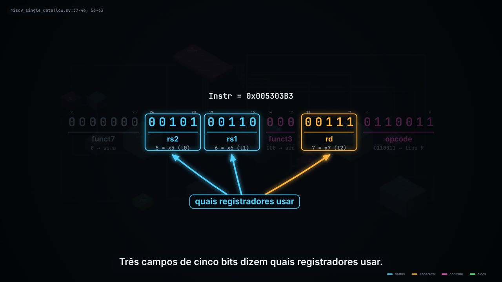

<!-- NOTA PARA O PROF. MENOTTI (comentário HTML: não aparece na página renderizada; apague antes do merge)
1. O vídeo mostra os sinais das linhas 11-20 de riscv_single_dataflow.sv do LightRISCV (SrcB, Result,
   RegWrite, MemWrite...), que são o gabarito das sete lacunas do exercício avaliado sim/08-riscv-mono
   deste repositório. Se o prazo da turma ainda não passou, talvez prefira fazer o merge depois.
2. A pasta anim/riscv-mono/ é só uma sugestão. Ela não depende de nada fora dela (os links para o
   LightRISCV são URLs completas), então pode ir para sim/08-riscv-mono/, labs/ ou onde preferir.
   O site (mkdocs) publica só as pastas ligadas em docs/; para a animação aparecer lá, bastaria
   um link simbólico docs/anim -> ../anim.
3. Os nomes dos sinais seguem o arquivo do LightRISCV (SrcA, SrcB, ALUResult, Result, RegWrite). Se em
   aula for usada outra nomenclatura, consigo regenerar o vídeo com os nomes trocados.
-->

# Animação: o caminho de `add t2, t1, t0` no RISC-V monociclo

*Narrated animation (in Portuguese, with subtitles) of one `add` instruction through the single-cycle datapath in `riscv_single_dataflow.sv`, with an interactive step-by-step page. All values come from the Icarus Verilog simulation of `fibo.asm`.*

**Figura 1.** Quadro do [vídeo no YouTube](https://www.youtube.com/watch?v=0cOjZgZDJ_0) (cerca de 3 min, narrado e legendado). A versão interativa está em [`riscv-mono_add.html`](riscv-mono_add.html).

## O que o vídeo mostra

O vídeo abre no FPGA Cyclone V da placa DE0-CV usada nos laboratórios (`mm/labs/DE0_CV.qsf:3-4`), tira a tampa do encapsulamento e entra no caminho de dados. Depois congela o tempo numa única instrução, separa os 32 bits em campos (setas apontam cada campo enquanto a narração fala dele) e segue o valor fio a fio até a borda do clock. O ritmo é ditado pela narração: cada frase espera a cena correspondente.

A peça acompanha uma única instrução, `add t2, t1, t0` (`add x7, x6, x5`, linha 12 de [`fibo.asm`](https://github.com/menotti/lightriscv/blob/HEAD/fibo.asm)), na quarta passagem pelo laço que gera a sequência de Fibonacci. Nesse instante `PC = 0x0000000C`, `Instr = 0x005303B3`, `t1 = 3`, `t0 = 2`, e o resultado `t2 = 5` é gravado na borda de subida do clock.

A ideia central é a do processador monociclo: todo o caminho de dados é combinacional e calcula ao mesmo tempo; os sinais de controle apenas escolhem o que vale. Por isso o vídeo também mostra os fios que carregam valores sem efeito, como `DataAddress = 5` e `WriteData = 2`, que chegam à memória de dados e são barrados por `MemWrite = 0`.

O fecho usa os 47 valores que o próprio processador gravou na memória de dados (`harvard_data.out`) para montar a espiral de Fibonacci. Nenhum número do vídeo foi digitado à mão.

## Passo a passo

A Tabela 1 relaciona cada etapa da animação com as linhas de [`riscv_single_dataflow.sv`](https://github.com/menotti/lightriscv/blob/HEAD/riscv_single_dataflow.sv) do [LightRISCV](https://github.com/menotti/lightriscv). Os valores são do ciclo em que `PC = 0x0C` na quarta passagem pelo laço.

**Tabela 1.** Etapas do `add` e sua origem no código.

| # | Etapa | Sinal e valor | Linhas |
|---|---|---|---|
| 1 | PC endereça a memória de instruções | `PC = 0x0C` | 4, 33-34; `mem.sv:12` |
| 2 | A instrução sai da memória | `Instr = 0x005303B3` | 5 |
| 3 | Só um comparador de opcode acende | `isALUreg = 1` | 37-46 |
| 4 | Campos de registrador | `rs1Id_A1 = 6`, `rs2Id_A2 = 5`, `rdId_A3 = 7` | 56-58 |
| 5 | Leitura combinacional do banco | `rs1 = 3`, `rs2 = 2` | 22-24 |
| 6 | `SrcA` recebe `rs1` | `SrcA = 3` | 18 |
| 7 | Mux `SrcB` escolhe `rs2` | `isALUreg = 1` → `SrcB = 2` | 19-20 |
| 8 | Somador da ULA | `aluPlus = 5` | 68 |
| 9 | `funct3 = 000` e `funct7[5] = 0`: soma | `ALUResult = 5` | 100-101 |
| 10 | Mux de resultado escolhe a ULA | `ResultSrc = isLoad = 0` → `Result = 5` | 15-16 |
| 11 | Calculado, mas não escolhido | `DataAddress = 5`, `WriteData = 2`, `MemWrite = 0` | 11-13 |
| 12 | Borda de subida do clock | `x7 ← 5` e `PC ← 0x10` | 25-27, 29-34 |

## Versão interativa

Abra [`riscv-mono_add.html`](riscv-mono_add.html) em qualquer navegador (arquivo único, funciona sem internet, também no celular). Os botões e as setas ← → percorrem os doze passos da Tabela 1; a barra deslizante percorre o vídeo inteiro. Ao passar o mouse sobre um fio ou um componente, a página mostra o nome do sinal, a largura em bits, o valor naquele passo e a linha de origem no `.sv`. Um painel exibe `t0`, `t1`, `t2`, `s0` e `PC` a cada instante.

## Como os valores foram obtidos

Os números do vídeo saem de uma simulação em Icarus Verilog do [`riscv_single_dataflow.sv`](https://github.com/menotti/lightriscv/blob/HEAD/riscv_single_dataflow.sv) rodando o `fibo.asm`, com os mesmos `.hex` do exercício [`sim/08-riscv-mono`](https://github.com/menotti/mm/tree/HEAD/sim/08-riscv-mono). Um test bench gravou os sinais internos a cada ciclo, e a animação foi gerada a partir desse registro. A voz é sintetizada (Microsoft Edge, `pt-BR-AntonioNeural`). Os fontes da animação e do test bench não foram incluídos para manter a pasta enxuta; posso enviá-los se forem úteis.

## Simplificações

1. Não há módulo separado de controle: a decodificação são os `wire is*` (linhas 37-46) e os campos (56-63) dentro do mesmo módulo. O bloco "decodificador" do desenho é essa região lógica.
2. O deslocador, os comparadores `LT`/`LTU`/`EQ` e o somador `PC + Jimm` (linha 31) existem no código, mas ficam fora de foco.
3. `jal` está incompleto no LightRISCV (não escreve `ra`); o laço é mostrado apenas como o retorno do `PC`.
4. No exercício `sim/08-riscv-mono` o banco escreve na borda de descida (`riscvmono.sv:20-22`). Aqui, como no arquivo, a escrita é na borda de subida (linhas 25-27).

## Referências

- LEVY, B. *From Blinker to RISC-V*. Disponível em: <https://github.com/BrunoLevy/learn-fpga/tree/master/FemtoRV/TUTORIALS/FROM_BLINKER_TO_RISCV>. [^1]
- HARRIS, S. L.; HARRIS, D. M. *Digital Design and Computer Architecture: RISC-V Edition*. Elsevier, 2021. [^2]
- PATTERSON, D.; WATERMAN, A. *Guia Prático RISC-V: Atlas de uma Arquitetura Aberta*. 2017. Disponível em: <http://www.riscvbook.com/portuguese/>. [^3]
- MENOTTI, R. *Microprocessadores e Microcontroladores*. UFSCar. Disponível em: <https://github.com/menotti/mm>.

[^1]: Origem do caminho de dados usado em `riscv_single_dataflow.sv`.
[^2]: Nomenclatura dos sinais (`SrcA`, `SrcB`, `ALUResult`, `Result`, `RegWrite`).
[^3]: Formatos de instrução e nomes ABI dos registradores (slides 05 da disciplina).
