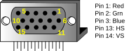
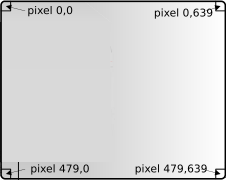
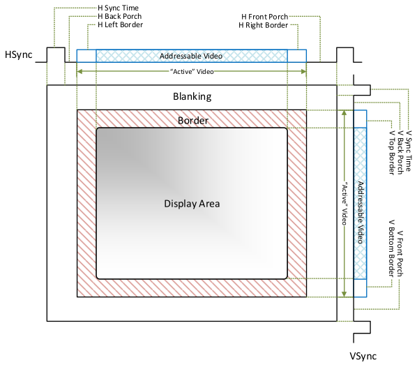
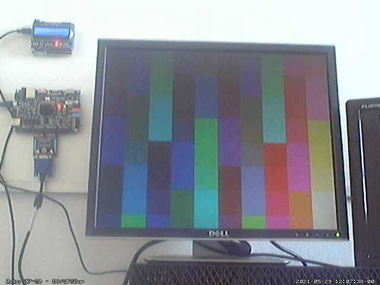
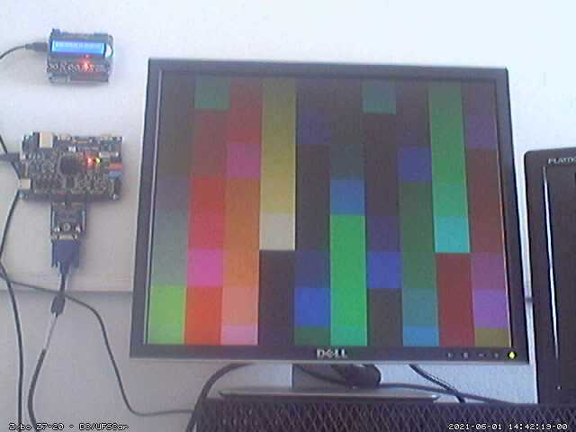
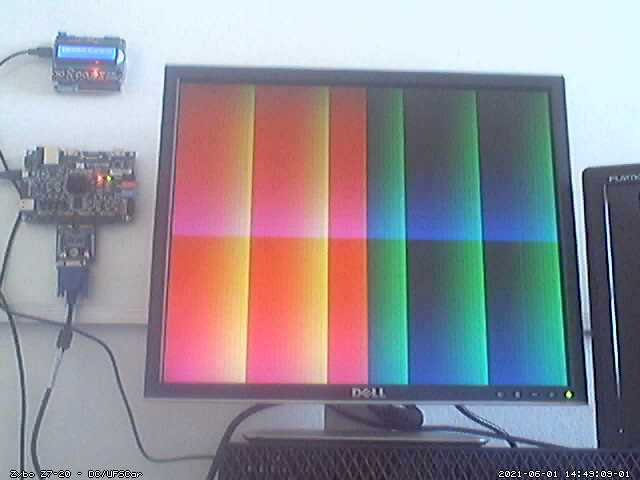
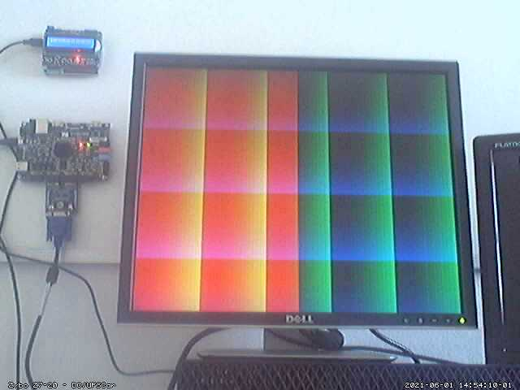

# Trabalho Nº 5

## VGA: gerando sinal de vídeo

## 1. Instruções Gerais

- Grupos definidos no AVA da disciplina;
- Ler o documento sobre Normas para entrega dos Relatórios;
	- Opcionalmente, o relatório pode ser escrito no `README.md`;
- Ler atentamente todo o enunciado deste trabalho antes de realizá-lo;
- Consultar as referências adicionais e manuais sempre que necessário;
- A entrega será no repositório gerado para o grupo no Classroom 50.
- Tornar todo o código disponível no repositório, com instruções de reprodução dos experimentos realizados.

## 2. Objetivos da Prática

- Familiarizar-se com linguagens de descrição de hardware, como Verilog;
- Conhecer o funcionamento do sinal de vídeo VGA;
- Projetar ou modificar um processador simples em Verilog;
- Descrever as atividades gerais desenvolvidas no trabalho em um relatório.

## 3. Materiais e Equipamentos

- VS Code no Linux ou usando [WSL](https://www.vlab.dc.ufscar.br/tutoriais/Sim/#wsl);
- Simuladores online como o EDA Playground;
- [Laboratório Remoto de Lógica Digital](https://legacy.vlab.dc.ufscar.br/camera.php) - DC/UFSCar (online).

## 4. Fundamentos teóricos

Neste trabalho serão usadas duas abordagens para a geração de sinal de vídeo, comparando suas vantagens e limitações.

### 4.1. Hardware vs. software

Inicialmente, serão retomados os conceitos abordados na aula com o mesmo título desta subseção. O software é essencialmente temporal, enquanto o hardware é essencialmente espacial, embora possa haver nuances nessas associações.

Na abordagem de hardware, podem ser desenvolvidas soluções especializadas para um determinado problema, obtendo, em geral, melhor desempenho. Porém, dependendo do problema, a solução pode demandar alto esforço de projeto.

Na abordagem de software, adota-se um processador — um hardware de propósito geral — e desenvolve-se um programa usando suas instruções. A complexidade da programação e o desempenho obtido dependem do conjunto de instruções da arquitetura-alvo e da linguagem adotada. Em geral, são inversamente proporcionais: para obter melhor desempenho, é necessário aprofundar o conhecimento da linguagem e da arquitetura utilizadas.

### 4.2. Sinal de vídeo VGA

VGA significa Matriz de Gráficos de Vídeo (*Video Graphics Array*) e refere-se especificamente ao hardware de exibição introduzido com o computador IBM PS/2, em 1987. Com sua adoção generalizada, o nome passou a se referir aos padrões de exibição de computador analógico (por exemplo, monitores CRT), ao conector DB-15 (comumente conhecido como conector VGA) ou à resolução de 640 × 480 usada neste trabalho.



Figura 1: Pinos de interesse no conector VGA (DB-15).

Serão considerados apenas cinco dos 15 pinos, apresentados na Figura 1: Vermelho (*Red*), Verde (*Grn*), Azul (*Blue*), Sincronismo Horizontal (HS) e Sincronismo Vertical (VS). Red, Grn e Blue são três sinais analógicos que especificam a cor de um ponto na tela, enquanto HS e VS fornecem uma referência de posição para sua exibição. Gerando adequadamente esses cinco sinais de acordo com a especificação de temporização VGA, é possível exibir imagens em um monitor.

Desenvolvido inicialmente para monitores CRT (tubos de raios catódicos), o padrão tem particularidades inerentes a esses monitores. Boa parte dos monitores LCD digitais também suporta o padrão VGA em diversas resoluções. A Figura 2 destaca as posições limítrofes para a resolução 640 × 480 que será gerada. Cada quadro inicia na posição 0,0 e segue na horizontal até concluir a linha. Um pulso em HS sinaliza o início da próxima linha, e assim sucessivamente. Ao final do quadro, um pulso em VS indica seu término e o início do próximo. Há intervalos específicos, que variam com a resolução, entre o último pixel da linha ou coluna e o pulso de sincronismo horizontal ou vertical.



Figura 2: Posição dos pixels na imagem gerada.

Na Figura 3 estão indicadas as faixas de temporização para a resolução 640 × 480, detalhadas na Tabela 1.



Figura 3: Especificação de tempo para resolução de 640 × 480 a 60 Hz.

| Descrição | Notação | Tempo | Largura/Frequência |
|:---|:---:|---:|---:|
| Pixel Clock | $t_{clk}$ | 39,7 ns (± 0,5%) | 25,175 MHz |
| H Sync Time | $t_{hs}$ | 3,813 µs | 96 pixels |
| H Back Porch | $t_{hbp}$ | 1,907 µs | 48 pixels |
| H Front Porch | $t_{hfp}$ | 0,636 µs | 16 pixels |
| H Address Video Time | $t_{haddr}$ | 25,422 µs | 640 pixels |
| V Sync Time | $t_{vs}$ | 0,064 ms | 2 linhas |
| V Back Porch | $t_{vbp}$ | 1,048 ms | 33 linhas |
| V Front Porch | $t_{vfp}$ | 0,318 ms | 10 linhas |
| V Address Video Time | $t_{vaddr}$ | 15,253 ms | 480 linhas |

Tabela 1: Especificação de tempo para resolução de 640 × 480 a 60 Hz.

### 4.3. Primeiro exemplo: hardware

No primeiro exemplo, puramente em hardware, são usados os contadores `CounterX` e `CounterY` para gerar os sinais de sincronismo nos momentos corretos e garantir que os valores de RGB sejam apresentados somente na área visível (`inDisplayArea`):

```verilog
module vga(
  input clk, // 25MHz
  output [3:0] VGA_R, VGA_G, VGA_B,
  output VGA_HS_O, VGA_VS_O);

  reg [9:0] CounterX, CounterY;
  reg inDisplayArea;
  reg vga_HS, vga_VS;
```

`CounterXmaxed` e `CounterYmaxed` assumem valores maiores do que os da resolução, pois incluem os tempos adicionais de sincronismo já descritos:

```verilog
wire CounterXmaxed = (CounterX == 800); // 16 + 48 + 96 + 640
wire CounterYmaxed = (CounterY == 525); // 10 + 2 + 33 + 480

always @(posedge clk)
  if (CounterXmaxed)
    CounterX <= 0;
  else
    CounterX <= CounterX + 1;

always @(posedge clk)
  if (CounterXmaxed)
    if (CounterYmaxed)
      CounterY <= 0;
    else
      CounterY <= CounterY + 1;
```

Os valores dos contadores são comparados para calcular as variáveis `vga_HS` e `vga_VS`, que, depois de invertidas, dão origem aos pulsos de sincronismo. A variável `inDisplayArea` indica a área visível, na qual os valores dos pixels podem ser enviados; fora dela, os valores devem ser zerados. O sinal gerado é apresentado na Figura 4.





Figura 4: Sinal de vídeo VGA gerado via hardware.

```verilog
always @(posedge clk)
begin // HS active for 96 clocks
  vga_HS <= (CounterX > (640 + 16) && (CounterX < (640 + 16 + 96)));
  vga_VS <= (CounterY > (480 + 10) && (CounterY < (480 + 10 + 2)));
end // VS active for 2 clocks

always @(posedge clk)
  inDisplayArea <= (CounterX < 640) && (CounterY < 480);

assign VGA_HS_O = ~vga_HS;
assign VGA_VS_O = ~vga_VS;
```

O adaptador de vídeo possui 4 bits para cada canal de cor, possibilitando $2^{12} = 4096$ combinações de cores [3, 4]. Para o canal vermelho, a tela é dividida ao meio verticalmente: a intensidade máxima é exibida do lado esquerdo e nenhuma intensidade, do lado direito. Para o canal verde, são usados os bits 6 a 3 de `CounterX`, gerando um gradiente de 128 pixels na horizontal, que cabe cinco vezes na largura da tela. Para o canal azul, o exemplo usa os bits 7 a 4 de `CounterY`, gerando um gradiente de 256 pixels na vertical. Esse gradiente cabe quase duas vezes na altura, com 224 pixels na parte inferior. Ao usar os bits 6 a 3 do mesmo contador, obtém-se um padrão quadrado, cuja última linha é cortada.

```verilog
assign VGA_R = inDisplayArea && CounterX < 320 ? 4'b1111 : 4'b0000;
assign VGA_G = inDisplayArea ? CounterX[6:3] : 4'b0000;
assign VGA_B = inDisplayArea ? CounterY[7:4] : 4'b0000;
```

Este exemplo mostra que gerar imagens de acordo com a posição dos pixels na tela é relativamente simples, pois não é necessário armazenar informações adicionais.

### 4.4. Segundo exemplo: *framebuffer*

> Este exemplo está baseado no processador uP1, mas também pode ser desenvolvido usando um processador [RISC-V](https://github.com/menotti/lightriscv) que contém muito mais recursos e ferramentas disponíveis. 

Um *framebuffer* é uma porção de memória usada para armazenar uma imagem. No segundo exemplo, essa técnica é usada com o uP1, ou seja, em uma abordagem por software. A memória foi modificada e agora possui portas adicionais de endereço (`vaddr`) e dados (`vdata`). Na resolução máxima e com a profundidade de cores adotada, seriam necessários 1,2 MB de memória, sem alinhamento. Além do espaço insuficiente, isso complicaria o acesso, pois dois canais de cor (4 bits) ficariam em uma palavra e o terceiro canal na palavra seguinte, misturado com o pixel seguinte.

```verilog
module mem #(parameter filename = "ram.hex")
           (input clock, we,
            input [7:0] address,
            inout [7:0] data,
            input [7:0] vaddr,
            output [7:0] vdata);

  logic [7:0] RAM[255:0];

  initial
    $readmemb(filename, RAM);

  assign data = we ? 'bz : RAM[address];
  assign vdata = RAM[vaddr];

  always @(posedge clock)
    if (we) RAM[address] <= data;
endmodule
```

A solução envolve reduzir a resolução e a profundidade de cores. No hardware, os dois bits menos significativos de cada canal são fixados em zero e usam-se apenas os outros dois. Isso permite armazenar um pixel nos seis bits menos significativos da palavra de memória, deixando os outros dois sem uso para facilitar o alinhamento. A intensidade máxima de cada canal cai de 15 (`1111`) para 12 (`1100`), resultando em $2^6 = 64$ cores.

Para reduzir a resolução, o máximo divisor comum entre 640 e 480 é 160, que não é potência de 2. Considera-se então 128, a potência de 2 imediatamente inferior, e obtém-se 32 para a dimensão do pixel virtual. Se cada endereço de memória representar 32 × 32 pixels, a resolução seria 20 × 15. Como o padrão VGA não suporta essa resolução tão baixa, a resolução do hardware permanece em 640 × 480 e são criados “pixels virtuais” de 32 × 32, cada um armazenado em um endereço de memória. Ainda assim, seriam necessárias 300 posições de memória, mas há apenas 256. A solução é usar “pixels virtuais” de 64 × 64. Assim, há dez pixels na largura e 7,5 na altura, e a última linha é desenhada pela metade. A imagem pode ser representada com 80 palavras de memória na resolução 10 × 8.

No módulo de vídeo, são feitas modificações para: (i) obter um endereço de memória (`vaddr`) a partir da posição da tela; e (ii) receber os dados da memória (`vdata`) e enviá-los para o vídeo. As duas portas são adicionadas ao código, respectivamente como saída e entrada, junto com duas variáveis para calcular a linha e a coluna:

```verilog
module vga(
  input clk, reset,
  input [7:0] vdata,
  output [7:0] vaddr,
  output [3:0] VGA_R, VGA_G, VGA_B,
  output VGA_HS_O, VGA_VS_O);

  reg [9:0] CounterX, CounterY;
  reg inDisplayArea;
  reg vga_HS, vga_VS;

  wire CounterXmaxed = (CounterX == 800); // 16 + 48 + 96 + 640
  wire CounterYmaxed = (CounterY == 525); // 10 + 2 + 33 + 480
  wire [3:0] row, col;
```

Para obter esses valores, os contadores são deslocados seis bits para a direita (divididos por 64) e combinados para obter a posição de memória desejada. O bit mais significativo é fixado em 1, usando as posições de memória 128 em diante. A parte mais baixa do endereço é composta pela linha:

```verilog
assign row = (CounterY >> 6);
assign col = (CounterX >> 6);
assign vaddr = {1'b1, col[3:0], row[2:0]};
```

Os valores recebidos da memória são atribuídos aos respectivos canais de cor nos bits mais altos, mantendo os bits mais baixos em zero:

```verilog
assign VGA_R = inDisplayArea ? {vdata[5:4], 2'b00} : 4'b0000;
assign VGA_G = inDisplayArea ? {vdata[3:2], 2'b00} : 4'b0000;
assign VGA_B = inDisplayArea ? {vdata[1:0], 2'b00} : 4'b0000;
```

O novo arranjo de memória é informado no arquivo `tables.py` do montador. São usadas 80 posições das 112 anteriormente não usadas:

```python
space_table = {          # dec    | bin               | hex
    "code":   128,        # 0:127  | 00000000:01111111 | 00:7f
    "video":   80,        # 128:207| 10000000:11001111 | 80:cf
    "unused":  32,        # 208:239| 11010000:11101111 | d0:ef
    "data":    16         # 240:255| 11110000:11111111 | f0:ff
}
```

As restrições de endereçamento continuam e se agravam, pois há um número limitado de bits para endereçar memória de código, dados e vídeo. Foram criadas instruções diferentes para acessar a memória de vídeo, mantendo as demais instruções como estavam. `LDV` e `STVI` não têm argumentos e fazem, respectivamente, carga e armazenamento em uma posição preestabelecida da memória de vídeo. A posição inicial é 128 e a final, 207. `LDV` carrega da posição corrente e `STVI` armazena e incrementa o endereço de vídeo para a próxima posição.

O programa a seguir busca cada endereço do vídeo, decrementa o valor em uma unidade e salva-o de volta. O montador reconhece o rótulo especial `.video` para inicializar a memória de vídeo com as palavras correspondentes às cores. No exemplo real, são adicionados dois laços aninhados para atrasar o programa e permitir a visualização, o que também exige um salto condicional.

```asm
loop:
    LDV
    SUB one
    STVI
    JUMP loop
.video
    0x00,0x00,0x01,0x02,0x03,0x03,0x04,0x05,0x06,0x07,0x07,0x08,0x09,0x0A,...
.one 1
```

Para suportar o adaptador de vídeo, é criado o endereço de vídeo `vaddr`, que aponta para o início do *framebuffer* após o reset do processador:

```verilog
if (reset) begin
  pc <= 'b0;
  vaddr <= 8'b10000000; // 128
  state <= FETCH;
end
```

No estado de decodificação da instrução, é necessário diferenciar o endereço de acesso à memória, pois `LOAD` e `STORE` o codificam na instrução, enquanto `LDV` e `STVI` usam o novo ponteiro:

```verilog
DECODE: begin
  ir = mbr;
  if (ir[7:5] == 3'b000)       // load/store video
    mar <= vaddr;
  else
    mar <= {4'b1111, ir[3:0]};
end
```

Por fim, `LDV` executa exatamente como `LOAD`, mas `STVI` incrementa o ponteiro e verifica se ele chegou ao final do *framebuffer*, retornando-o ao início:

```verilog
else if (ir[7:4] == 4'b0001) // store video
begin
  we <= 1'b1;
  vaddr <= vaddr + 1;
  if (vaddr > 207)
    vaddr <= 8'b10000000; // 128
end
```

A Figura 5 apresenta o quadro inicial e o obtido após algumas iterações:





Figura 5: Sinal de vídeo VGA gerado via hardware e software.

## 5. Procedimentos

Para a realização deste trabalho, o grupo deverá implementar obrigatoriamente no mínimo três configurações diferentes de hardware e/ou software e testá-las no laboratório virtual. As duas primeiras implementações serão realizadas por todos os grupos. A terceira pode ser escolhida livremente a partir do número 3 da lista a seguir e deverá ser informada com antecedência no fórum de dúvidas da disciplina. Cada grupo deverá escolher uma opção diferente:

1. **(obrigatório)** Modificar o exemplo de hardware para gerar uma imagem que não seja baseada apenas nos contadores X e Y. Pode-se usar, por exemplo, uma função simples desses contadores;
2. **(obrigatório)** Usando o uP1 atual ou RISC-V, implementar uma animação significativamente diferente daquela fornecida. Por exemplo, deslocar uma imagem inteira na tela;
3. Adaptar uma implementação do algoritmo de Mandelbrot para rodar no hardware. Será necessário usar uma biblioteca de ponto flutuante ou gerar *IP cores* no Vivado;
4. Modificar o adaptador de vídeo atual do uP1 para funcionar com um mapa de caracteres (modo texto). Nesse caso, uma ROM é usada para armazenar o mapa e a memória de vídeo armazena qual caractere está em cada posição;
5. Implementar ou adaptar o processador IAS, SAP-1 ou outro qualquer para funcionar com o adaptador de vídeo fornecido ou modificado;
6. Modificar o *framebuffer* para usar a resolução 20 × 15 (com “pixel virtual” de 32 × 32) e executar o programa do item 2. Será necessário aumentar o tamanho da memória e o conjunto de instruções;
7. Implementar uma animação com funções trigonométricas usando software e/ou hardware;
8. Implementar um jogo simples usando software e/ou hardware.
9. Plotar uma imagem vetorial usando software e/ou hardware.
10. Usar a "quarta parte" do RGB para criar efeitos de BIA (blink, intensity, alpha).
11. Implementar um relógio e/ou cronômetro.
12. Implementar um jogo usando o conceito de sprite.
13. Implementar um leitor/gerador de Código Morse.
14. Implementar um gerador de código de barras ou QR.
15. Implementar um gerador de imagens 3D.  

## Referências Bibliográficas

- [Playlist sobre Verilog](https://www.youtube.com/playlist?list=PLhaFCmjMNuYZjAdJtC2WfDeHgR3daM9Tm)
- [Verilog Tutorial](http://asic-world.com/verilog/)
- [VGA Display Controller](https://reference.digilentinc.com/learn/programmable-logic/tutorials/vga-display-congroller/start)
- [Pmod VGA Reference Manual](https://reference.digilentinc.com/pmod/pmodvga/reference-manual)
- [LightRISCV](https://github.com/menotti/lightriscv)
- [uP1](https://github.com/menotti/up1/)
- [Simple microprocessor using Verilog](https://stackoverflow.com/questions/51592244/implementation-of-simple-microprocessor-using-verilog)
- [IAS: instruções e simulador](https://www.ic.unicamp.br/~edson/disciplinas/mc404/2017-2s/abef/IAS-sim/)
- [SAP-1: instruções e simulador](https://embarcados.com.br/projeto-do-sap-1-construido-no-simulador/)
